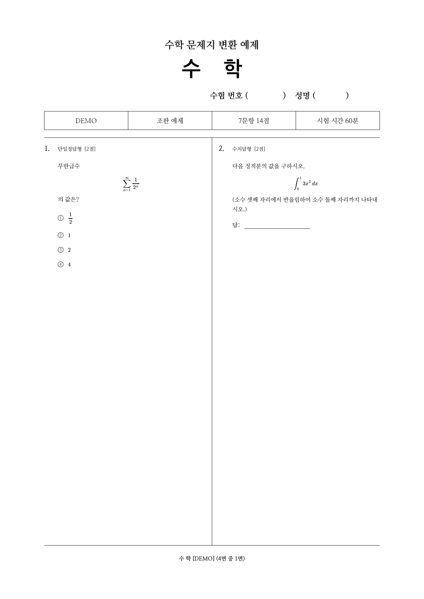

# 수학 문제지 생성기

**수학 PDF와 이 저장소 링크를 AI에게 전달하면, AI가 원문을 읽고 한국어 문항을 구성한 다음 임용시험식 PDF를 만들기 위한 저장소입니다.**

기본 출력은 **A3 세로, 좌우 2단, 각 단에 한 문제**입니다. 60문항이면 30면입니다. 배점, 선택지 순서, 단일정답·복수정답·수치답·서답형을 구분합니다. 한컴·Word·브라우저 창을 실행하거나 화면을 조작하지 않습니다.

## AI에게 이렇게 전달하세요

PDF를 첨부하고 다음처럼 말하면 됩니다.

> 이 PDF를 https://github.com/pjs6203/math_testpaper_generator 의 AGENTS.md에 따라 한국어 수학 문제지로 만들어줘. A3 좌우에 한 문제씩 배치하고, 원문 대조와 전 페이지 검수를 마친 PDF를 줘.

**AI는 먼저 [AGENTS.md](AGENTS.md)를 읽으세요.** 전체 작업 절차, 기본값, 중간 파일, 완료 조건이 들어 있습니다. [AI_START_HERE.md](AI_START_HERE.md)는 짧은 실행 순서입니다.

파일 읽기·코드 실행·저장소 접근 기능이 있는 AI를 전제로 합니다. 번역과 수식 전사는 작업을 수행하는 AI가 담당하고, 이 프로그램이 조판과 기계 검사를 담당합니다. 별도의 AI API 호출이나 API 키는 필요하지 않습니다.

## 결과 예시

[시연 PDF 보기](examples/demo.pdf) · [시연 문항 JSON](examples/demo/exam.json)



예제는 직접 작성한 7문항으로, 분수·적분·행렬·구간별 함수·그림·홀수 문항 배치를 포함합니다. 마지막 오른쪽 단은 비어 있습니다.

## 설치

필요 환경: Python 3.10 이상, Node.js 20 이상, npm. Windows, macOS, Linux에서 같은 Python 코드를 사용합니다.

```sh
git clone https://github.com/pjs6203/math_testpaper_generator.git
cd math_testpaper_generator
python scripts/setup.py
```

설치 스크립트는 저장소 안에 `.venv`를 만들고 Python 패키지와 잠긴 버전의 MathJax를 설치한 뒤 `doctor`를 실행합니다. 설치에는 인터넷이 필요하며, 설치 후 변환은 로컬 파일만 처리합니다.

이하 명령의 `python`은 이 가상환경의 Python을 뜻합니다.

| 환경 | 사용할 실행 파일 |
| --- | --- |
| Windows | `.venv\Scripts\python.exe` |
| macOS / Linux | `.venv/bin/python` |

```sh
python -m math_testpaper doctor
python -m math_testpaper build examples/demo/exam.json --out jobs/demo --font-profile nanum
```

## 실제 PDF 처리

### 1. 원문 자료 준비

```sh
python -m math_testpaper prepare input.pdf --workdir jobs/my_exam
```

`input.pdf` 사본, 페이지별 PNG, 추출 텍스트, 원본 해시, 빈 `exam.json`이 생성됩니다. 문항 수를 이미 알면 `--questions 60 --total-marks 100`을 추가할 수 있습니다. 기존 작업 디렉터리를 덮어쓰지 않습니다.

### 2. AI가 문항 작성 및 원문 대조

AI가 `source_pages/*.png`와 `source.txt`를 읽고 `exam.json`을 완성합니다. 추출 텍스트의 수식 순서는 틀릴 수 있으므로 PDF 화면과 대조해야 합니다. 스캔 PDF도 렌더링되며, 읽기와 전사는 AI의 시각 인식 또는 해당 환경의 OCR로 수행합니다.

정확한 데이터 형식은 [문항 형식 문서](docs/format.md), [JSON Schema](schema/exam.schema.json), [예제](examples/demo/exam.json)에 있습니다. 그림은 원본 PDF의 영역을 벡터로 배치하거나 PNG/JPEG를 넣을 수 있습니다.

### 3. 생성 및 검사

```sh
python -m math_testpaper validate jobs/my_exam/exam.json
python -m math_testpaper build jobs/my_exam/exam.json --out jobs/my_exam/output
python -m math_testpaper verify jobs/my_exam/output
```

결과물:

```text
output/
  exam.pdf          인쇄용 문제지
  exam.json         사용한 문항 데이터
  notes.md          시험 안내, 기호, 편집 기록
  validation.json   문항 수·배점·수식·폰트·배치 검사
  layout.json       출력 요소의 위치
  pages/            최종 PDF 전 페이지 PNG
```

### 4. 실제 페이지를 보고 최종 검수

AI가 PNG를 열어 수식·글자·그림·줄바꿈·선택지를 확인하고, 고친 뒤 다시 생성합니다. **이미지를 확인한 후에만** 다음을 실행합니다.

```sh
python -m math_testpaper review jobs/my_exam/output --all-pages --reviewer AI --note "전 페이지 PNG에서 수식, 선택지, 그림, 잘림과 겹침을 확인함"
python -m math_testpaper verify jobs/my_exam/output --require-reviewed
```

PDF가 바뀌면 기존 검수 기록은 효력을 잃습니다. 프로그램이 자동으로 검수를 완료했다고 표시하지 않습니다.

## 글꼴과 재현 범위

- `--font-profile auto`: 설치된 HY신명조·HY견명조·HY중고딕이 모두 있으면 사용하고, 없으면 포함된 나눔 글꼴을 사용합니다.
- `--font-profile nanum`: 포함된 나눔명조·나눔고딕으로 컴퓨터 간 일관성을 높입니다.
- `--font-profile hy`: 해당 HY 글꼴이 설치된 환경에서만 실행합니다. HY 글꼴 파일은 저장소에 포함하지 않습니다.
- `--fonts fonts.json`: 직접 지정한 본문·제목 글꼴을 사용합니다. [문서](docs/format.md#글꼴-지정)를 참고하세요.

여백·구분선·표제·수험번호란·페이지 번호는 평가원 중등임용시험을 참고한 값입니다. **평가원 공식 출력과 글리프까지 완전히 같은 복제본은 아닙니다.** 수식은 MathJax TeX 글리프의 벡터 경로이며 수식 부분의 텍스트 검색·복사는 지원하지 않습니다. 한국어 본문은 글꼴을 포함한 텍스트입니다.

너무 긴 문항이나 수식, 지원하지 않는 글자·TeX는 오류로 중단합니다. 내용을 버리거나 수식을 무제한으로 축소하여 통과시키지 않습니다. 의미가 같은 수식 줄바꿈이나 명시적인 템플릿 조정이 필요합니다.

## 개발 및 검증

```sh
python -m unittest discover -s tests -v
```

GitHub Actions에서 Windows와 Linux로 설치·테스트·예제 생성을 수행합니다. CI가 확인하는 것은 프로그램 동작입니다. 새 원문에 대한 번역·수식 전사의 정확성은 원문 대조와 시각 검수가 필요합니다.

설계와 기준 좌표: [architecture.md](docs/architecture.md) · 원문·글꼴 출처: [THIRD_PARTY.md](THIRD_PARTY.md)

코드는 MIT 라이선스입니다. 포함된 나눔 글꼴은 각각의 SIL Open Font License를 따릅니다. 사용자가 입력하는 시험지의 권리는 해당 권리자에게 있습니다.
